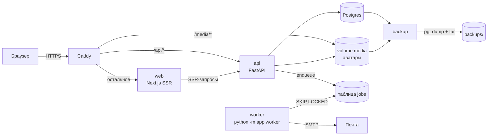

# Архитектура и онбординг

Документ для новых людей в команде: как устроена система, где что лежит и как за 30 минут дойти до первого PR.
Правила работы — в `AGENTS.md`, деплой — в `docs/deploy.md`.

## Схема



- **Один origin.** Caddy отдаёт `/api/*` в FastAPI, `/media/*` с диска, остальное — в Next. Поэтому нет CORS, а cookie сессии работает и для SSR, и для браузера.
- **Вся логика и права — в api.** Next только рисует. Типы TS-клиента генерируются из OpenAPI: `make gen-client`.
- **Фоновые задачи** живут в Postgres (таблица `jobs`), отдельного брокера нет. Воркер разбирает письма и раз в час шлёт напоминания основателям.

## Путь ключевого сценария: отклик

1. Новичок открывает `/startups/<slug>`. Страница рендерится на сервере, а браузер пишет `startup_viewed` (`POST /api/events`, хеш посетителя вместо IP).
2. Отклик: `POST /api/startup-roles/{id}/applications` проверяет минимальный профиль (`profiles.apply_blockers`), пишет `application_sent` и ставит письмо основателю в `jobs`.
3. Воркер отправляет письмо (HTML + текст, ссылка отписки). При ошибке SMTP — повтор через 1, 2, 4, 8 минут.
4. Основатель видит бейдж в шапке (`/api/me/inbox-count`) и принимает отклик: контакты открываются обеим сторонам, а если это было последнее место, набор закрывается сам (`team_assembled`).

## Где что лежит

| Что | Где |
|---|---|
| Модели, миграции | `apps/api/app/models`, `apps/api/alembic/versions` |
| Бизнес-логика | `apps/api/app/services` (по файлу на область: startups, applications, profiles, jobs, mail…) |
| Роуты и схемы | `apps/api/app/routers`, `apps/api/app/schemas` |
| События воронки | `app.services.events.track()`, каталог в `docs/events.md` |
| Метрики и гипотезы | `/admin`: воронка, H1–H8 (`services/hypotheses.py`), когорты D7/D30 (`services/retention.py`), CSV |
| Поиск | `app/db/search.py`: вычисляемые `tsvector` (russian) у стартапов, ролей и профилей, GIN-индексы, `websearch_to_tsquery` + `ts_rank`; запрос короче 3 символов — префикс названия |
| Подбор v0 | `services/startups.py::recommended`, показы пишутся в `recommendation_shown` |
| Дизайн-система | `docs/ux/design-system.md`, токены в `apps/web/src/app/globals.css`, компоненты мест `components/domain/seats.tsx` |
| UX-исследование | `docs/ux/research.md` (JTBD, CJM, гипотезы), доска Miro «Startup Platform: макеты MVP» |
| Тесты API | `apps/api/tests` (отдельная БД `app_test`) |
| E2E, скриншоты, axe | `apps/web/e2e` (`visual.spec.ts` — страницы на 1440 и 375 px) |
| CI | `.github/workflows/ci.yml`: api, web, e2e, images (prod-сборка, HTTPS, CSP, воркер, OG) |

## Онбординг за 30 минут

```bash
git clone git@github.com:slvtveter/startup-platform.git && cd startup-platform
make setup          # зависимости api и web, infra/.env из шаблона
make dev            # docker compose: db, api, worker, web, caddy, mailpit
make seed           # демо-данные, пароль у демо-аккаунтов demo12345
open http://localhost:8080        # сайт; письма — http://localhost:8025
make test           # тесты API
cd apps/web && npx playwright test   # E2E (для локального прогона поднимите AUTH_RATE_LIMIT в infra/.env)
```

Дальше: ветка → изменения → `make lint` → PR. CI должен быть зелёным, миграции смотрит хранитель схемы.

### ML-специалисту (подбор, KAN-90)
- Сырые данные — таблица `events`: `recommendation_shown`, `startup_viewed`, `application_sent`, `application_answered`. Схема props — в `docs/events.md`.
- Текущая эвристика — `services/startups.py::recommended`. Новый ранжировщик подключайте за тем же интерфейсом и пишите версию модели в события показов.
- Для экспериментов используйте `make seed` и синтетику. Реальные данные в local не копируем (AGENTS.md, правило 8).

### SEO-разработчику
- Метаданные страниц — `generateMetadata` в `apps/web/src/app/**/page.tsx`. Sitemap и robots — `src/app/sitemap.ts`, `robots.ts`.
- OG-картинки — `opengraph-image.tsx` у стартапа и профиля, общий рендер в `src/lib/og.tsx`.
- Замеры Lighthouse и как их повторить — `docs/seo.md`. Адреса стартапов и профилей неизменяемы по дизайну.

### Дизайнеру
- Начните с `docs/ux/design-system.md` и доски Miro. Скриншоты всех ключевых страниц прикладываются к каждому PR (артефакт CI `screens`).
